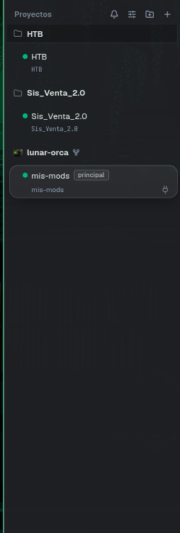
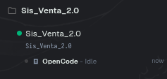
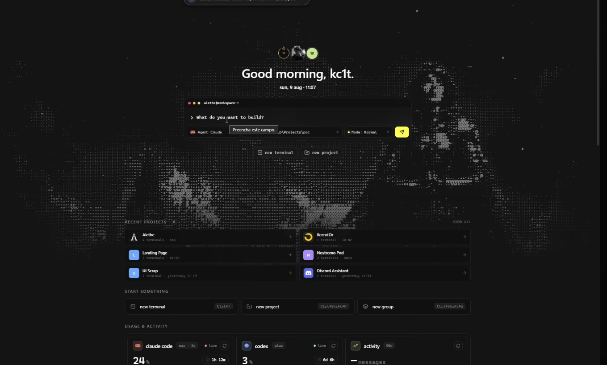
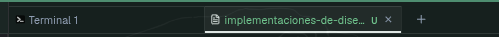
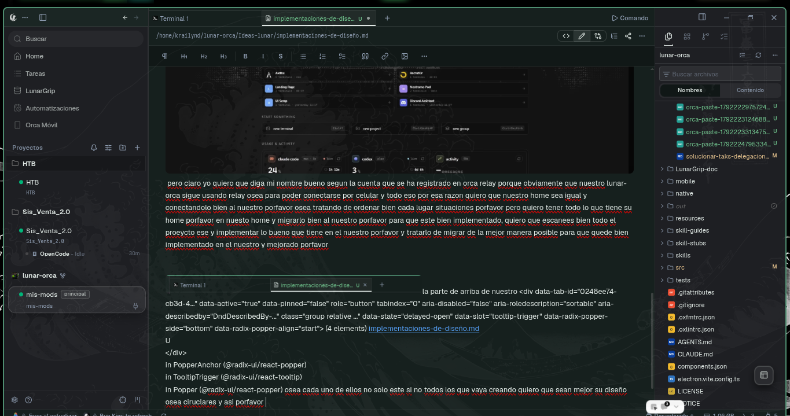

Si notas en la imagen esa es nuestra side bar izquierda donde estan todos nuestros proyectos que ponemos en lunar-orca, pero lo que yo quiero esque ahora lunar-orca reconozca herdr porque siempre usare herdr y claro cuando yo ejecuto herdr y ejecuto dentro de herdr un arnes o modelo de ia como tipo opencode dnetro de herdr pues Lunar-orca no lo reconoce y no no pone el modelo que esta trabajando en ese proyecto asi como lo ahce  y se nota que esta ahi pero claro quiero que tenga animaciones de que si esta trabajando o que no esta trabajando porfavor y con poca informacion de lo que hace el agente ojo que solo sea poca informacion no mucha  tambien se necesita mejorar el diseño de los workspace porfavor para que sean poco mas elegantes con animaciones porfavor, osea lo que se quiere hacer esque esa sesion que se ejecuta en herdr se recozca para ese workspace osea dentro del herdr usare modelos agntes  entonces quiero que sea recnocidos asi como se veia en el de sis venta 2.90 por lo que quiero que se implemente de la mejor forma todo lo que se tea diciendo porfavor para que quede de la mejor manera implementada   

ahora otra cosa este proyecto tiene un home mas y mucho mejor que el de nosotros y quiero implementarlo bien en nuestro home [https://github.com/Kc1t/alethe-agent](https://github.com/Kc1t/alethe-agents)  
este proyecto su home es un estilo a este  pero claro yo quiero que diga mi nombre bueno segun la cuenta que se ha registrado en orca relay porque obviamente que nuestro lunar-orca sigue usando relay osea para poder conectarse por celular y todo eso por esa razon quiero que nuestro home sea igual y conectandolo bien al nuestro porfavor osea tratando de ordenar bien cada lugar situaciones porfavor pero quiero tener todo lo que tiene su home porfavor en nuesto home y migrarlo bien al nuestro porfavor para que este bien implementado, quiero que escanees bien todo el proeycto ese y implementar lo bueno que tiene en el nuestro porfavor y tratarlo de migrar de la mejor manera posible para que quede bien implementado en el nuestro y mejorado porfavor   
  
  
la parte de arriba de nuestro &lt;div data-tab-id="0248ee74-cb3d-4..." data-active="true" data-pinned="false" role="button" tabindex="0" aria-disabled="false" aria-roledescription="sortable" aria-describedby="DndDescribedBy-..." class="group relative ..." data-state="delayed-open" data-slot="tooltip-trigger" data-radix-popper-side="bottom" data-radix-popper-align="start"&gt;
  (4 elements)
  [implementaciones-de-diseño.md](http://implementaciones-de-diseño.md)  
U  
&lt;/div&gt;  
  in PopperAnchor (@radix-ui/react-popper)  
  in TooltipTrigger (@radix-ui/react-tooltip)  
  in Popper (@radix-ui/react-popper) osea cada uno de ellos no solo este si no todos los que vaya creando quiero que sean mejor su diseño osea ciruclares y asi porfavor , tambien estoy notando que estos lugar "el fondo  
  
&lt;div class="relative h-full..."&gt;  
  &lt;div ...&gt;  
  Si notas en la imagen esa es nuestra side bar izquierda donde estan todos nuestros proyectos que pon...  
&lt;/div&gt;  
  in RichMarkdownEditorSurface (at /src/components/editor/RichMarkdownEditorSurface.tsx)  
  in RichMarkdownEditor (at /src/components/editor/RichMarkdownEditor.tsx)  
  in RichMarkdownErrorBoundary (at /src/components/editor/RichMarkdownErrorBoundary.tsx) esto  
  
&lt;div class="status-bar-usag..." data-overflowing="false"&gt;  
  &lt;div ...&gt;  
  Error al actualizar  
Run Kimi to refresh  
&lt;/div&gt;  
  in StatusBarSurface (at /src/components/status-bar/StatusBarSurface.tsx)  
  in RecoverableRenderErrorBoundary (at /src/components/error-boundaries/RecoverableRenderErrorBoundary.tsx)  
  in OverlayBoundary (at /src/app-shell/AppRootSurfaces.tsx) osea hasta el tab de arirba osea hay toda via color verde y deberia ser gris como el resto osea el fondo nada mas se neciesta mejorar todo eso e adaptarlo bien porfavor " el status bar de abajo quiero que se vea como se ve su status de agentes que tiene ese proyecto que te pase osea ese proyecto su status esta arriba pero yo lo quiero abajo bueno ya lo tengo abajo pero quiero que este mejor se vea el uso el porcentaje y todo eso bien con animaciones porfavor  
  
y tambien la transparencia que tiene ahora el lunar orca esta mal porque tiene mucha transparencia y quiero que le bajes la transparencia pero ojo fijate si el problema es de hyprland o de orca mismo porfavor para que mejores eso para que no tenga tanta transparencia y mejora mucho mas el diseño de cada punto lugar de lunar orca porfavor 