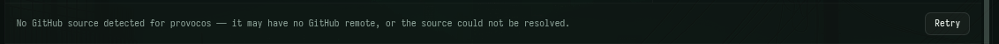

# Problemas con la parte de delegar tareas en tasks 

Los problemas esque cuando el ususario va a delegar una tareas tanto local como de github o iesus o prs lo que pasa esque claro al delegarlo a un agente sale la parte de escoger o crear un workspace o solo crear otro espcio de trabajo dentro de ese workspace pero al momento de que abre supongamos pi pues solo se abre pero no se inserta el prompt o todos los datos que deberia tener para que haga esa tareas, los otros problemas que encontre esque no se puede escoger como proyecto o carpeta normal /home/krailynd osea mi home no se puede usar como carpeta normal y eso se debe solucionar.  
  
para profundizar en este problema... lo mal esque claro el ususario va a tasks entra a proyectos locales o de github le pone o crea sus tareas pero al poder poner delegar a un agente como ejemplo que sea pi pero claro sale para crear un workspace o crear otro espacio de trabajo dentro del workspace entonces al poder entrar a pi de esa forma pues solo se abre pi u tambien asi con los otros agentes entonces al ponerle crear pues no se delega y no se hace la tareas y peor aun los agentes no tienen comunicacion inteligente con las tasks por lo que eso se debe solucionar y que los agentes si deben poder monitoriar saber o siempre y cuando se le diga fijense que tareas locales hay por hacer pero ojo tambien los agentes pueden dejar tareas crear tareas de los proyectos que se hagan con su ruta de proyecto osea los agentes deben saber todo lo que tiene el orca para poder usarlo de la mejor manera,   
tambien hay problemas con el github aqui en la imagen se ve que no reconoce mi proyecto de github que es provoco entonces pues se debe solucionar no solo para ese si no para todos porfavor y que orca como tambien todo reconzca todo lo que tengo en mi github
