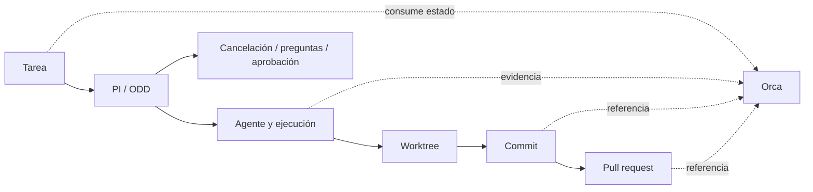

# Integración Orca, PI, ODD y trazabilidad

## Estado

| Capacidad | Estado |
|---|---|
| Contrato tipado de trazabilidad | **Implementado** |
| Representación de tarea y proyecto | **Parcial**: existe el flujo local de tareas |
| Autoridad de lifecycle en PI | **Contrato preparado**; Lunar Orca no crea otro lifecycle |
| Ejecuciones, checkpoints y cancelación | **Pendiente** de lectura desde las fuentes existentes |
| Worktree, commit y pull request | **Parcial** mediante superficies Git existentes; sin relación persistida con tareas locales |
| Persistencia de relaciones | **Pendiente** |
| Métricas de coste, tokens y duración | **No disponible** si no existe una fuente real |

## Contrato implementado

`src/shared/orca-task-traceability.ts` define:

- estado de lifecycle: `pending`, `in_progress`, `blocked`, `awaiting_approval`, `completed`, `failed`, `cancelled`;
- referencias opcionales a proyecto, agente, ejecución, worktree, commit, pull request y artefactos;
- dependencias y motivo de bloqueo;
- marcas temporales solo cuando una fuente real las proporciona;
- estados vacíos explícitos para evitar actividad, métricas o relaciones inventadas.

El constructor de estado vacío no crea nombres de agentes, commits, PRs, artefactos ni métricas. La UI debe mostrar esos estados como ausencia de evidencia, no como éxito.

## Autoridad y flujo

Orca consume y representa estados. No inicia un segundo proceso de lifecycle, no cancela directamente agentes y no declara completada una tarea sin evidencia del sistema de autoridad.

## Criterios de aceptación del siguiente bloque

1. Cada relación visible debe tener una fuente identificable o mostrar estado vacío.
2. Cancelación, preguntas, aprobación y finalización deben seguir pasando por PI.
3. Una tarea sin ejecución debe mostrar `No hay ejecuciones registradas.`.
4. Una tarea sin PR debe mostrar `No hay PR vinculada.`.
5. No se deben añadir tokens, costes, duración o nombres de agentes que no provengan de una fuente real.

## Rollback

El contrato es aditivo y no cambia persistencia ni lifecycle. El rollback consiste en revertir el archivo de contrato y su test; no requiere migraciones ni modifica sesiones PI.
