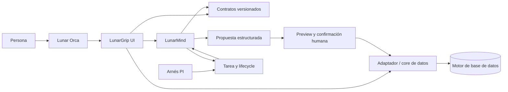

# Diagrama conceptual de arquitectura

## Lectura del diagrama

- PI coordina tareas y agentes; no se duplica dentro de LunarGrip.
- LunarGrip conserva contexto y presenta propuestas.
- El adaptador es el único límite que toca la base.
- La confirmación humana queda entre propuesta y mutación.
- El contrato permite que UI, agente y resultado se correlacionen.

## Diagrama de datos pendiente

No se genera un DER porque no se aportó una base de datos de LunarGrip ni un
esquema persistente decidido. Crear uno ahora sería inventar estructura. Cuando
se defina la persistencia, debe documentarse el DER con PK/FK y ciclo de vida.

